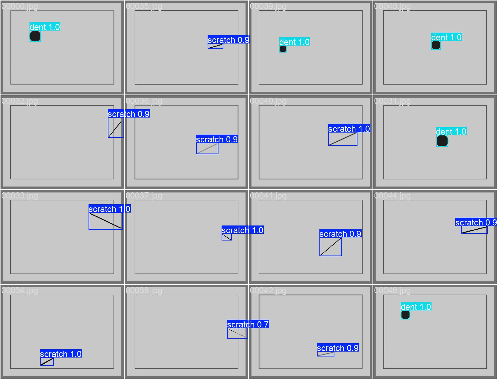

# Factory Vision

A YOLOv8n detector for surface scratches and dents, with a Streamlit inspection app, built end to end on synthetic images.



*Predictions on part of the synthetic validation set (`runs/detect/train3/val_batch0_pred.jpg`).*

## What it does

- `scripts/synth_defects.py` draws 640x480 grey panels, each with one defect: a dark line (`scratch`) or a dark filled circle (`dent`). About 30% get a light Gaussian blur. It writes 200 training and 60 validation images with YOLO labels.
- `train_model.py` fine-tunes the COCO-pretrained `yolov8n.pt` on that data.
- `run_infer.py` runs the trained weights over the validation folder and saves annotated images and label files.
- `app.py` is a Streamlit app for inspecting images with the trained model (see [App features](#app-features)).

## Results

Run `runs/detect/train3`: YOLOv8n, image size 640, batch 8, 30 epochs (`args.yaml`). Scores are from the last epoch in `results.csv`, which is also the best epoch.

| Metric | Validation (60 images, 35 scratches, 25 dents) |
|---|---|
| Precision | 0.993 |
| Recall | 1.000 |
| mAP50 | 0.995 |
| mAP50-95 | 0.948 |

The confusion matrix (`runs/detect/train3/confusion_matrix.png`) shows all 35 scratches and 25 dents found with the right class.

**Data note:** trained and validated on synthetic images generated by `scripts/synth_defects.py`; the scores show the pipeline works, not real-world accuracy.

A quick out-of-domain check makes the point. After `train3` was validated, three validation images (`00000.jpg`, `00011.jpg`, `00029.jpg`) were replaced with real photos of damaged cars; their label files were not updated. On those photos the model drew 8, 2 and 10 boxes, on tail lights, door handles, wheels, windows and plain panels, and missed the obvious dent in `00000` and `00011`. Re-running validation with those three files in place is unlikely to reproduce the table above. The three photos aren't in the repo because they're third-party images, so a fresh clone has 57 validation images for 60 label files.

## App features

`streamlit run app.py`

- **Live inspection:** upload an image or take a webcam snapshot. Detections are drawn with class and confidence, and a severity label (none, low, medium, high) is worked out from box area times confidence. The thresholds are fixed guesses, not calibrated.
- **Simulated line:** steps through a folder of images (default `dataset/images/val`) one at a time, like parts passing a camera, with a set delay.
- **Analytics:** images inspected, results per class (including OK) and the latest 50 log rows.
- **Logging:** uploads and snapshots are saved under `data/`, and every prediction appends rows to `logs/events.csv`, which can be downloaded from the app.
- **Sidebar settings:** model path, confidence threshold (default 0.35), NMS IoU threshold (default 0.5), image size, simulated-line folder and delay.

## How to run

```bash
python -m venv .venv
.venv\Scripts\activate          # Windows; use source .venv/bin/activate elsewhere
pip install -r requirements.txt
```

`dataset.yaml` holds absolute Windows paths; change them to where you cloned the repo.

**Generate data** (optional; the generated set is already in `dataset/`):

```bash
python scripts/synth_defects.py
```

It is not seeded, so each run gives a different dataset and overwrites `dataset/`.

**Train:**

```bash
python train_model.py
```

This uses the GPU (`device=0`) and appends a summary to `training_log.csv`. Note it is set to batch 16 with caching, while `train3` was trained with batch 8 and no cache.

**Validate:**

```bash
yolo val model=runs/detect/train3/weights/best.pt data=dataset.yaml
```

**Infer:**

```bash
python run_infer.py
```

Results go to a new `inference_results/preds*` folder on each run, with confidences in the label files. The committed `inference_results/preds` came from two runs into the same folder, so most of its label files list each box twice.

**App:**

```bash
streamlit run app.py
```

**Docker:** not available yet. `Dockerfile.txt` is an empty placeholder.

## Limitations

- The data is synthetic and easy: one high-contrast shape on a flat grey background. Near-perfect scores are expected and say little about real parts.
- Every image contains exactly one defect, so the model has never seen a defect-free part.
- It does not transfer to real photos (see the out-of-domain check above).
- No inference speed benchmark, ONNX export or container image yet.

## Next steps

- Train and test on real defect data such as NEU-DET (steel surface defects) or MVTec AD, and keep a held-out real test set.
- Add augmentations for lighting, texture, noise and perspective, plus defect-free images.
- Export to ONNX (`yolo export model=runs/detect/train3/weights/best.pt format=onnx`), then measure latency on an edge device.

## Tech stack

Python, Ultralytics YOLOv8 (pinned to 8.2.103), PyTorch, OpenCV, Streamlit, pandas, NumPy, Pillow.
